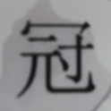
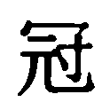
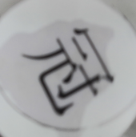
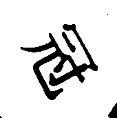

# 车型智能搬运机器人 · MaixCAM 视觉


> 2026 中国机器人大赛暨 RoboCup 中国赛 · **车型智能搬运**赛项
> 运行在 MaixCAM 上的视觉端：由 STM32F407 主控下发 1 字节模式码切换任务，回传 10 字节结果帧。

---

## 它在整台车上干什么

主控负责走位和机构，视觉只负责"看"：**找到同心圆并告诉主控偏了多少、认出物块的颜色和形状、读出奖杯上的"冠/亚/季"、判断奖杯是否进了抓取框**。

分工边界是刻意划清的——视觉从不直接控制电机，只输出坐标和结果码；主控用这些数据做闭环或状态跳转。这样任何一侧出问题都能单独排查。

```
STM32F407  ──1 字节模式码──▶  MaixCAM
           ◀──10 字节结果帧──
           UART4 · 115200 · 8N1
```

## 任务模式

| 命令 | 任务 | 输出内容 |
| --- | --- | --- |
| `0x01` | 任务一 · 同心圆对准 | 圆心坐标 + 居中标志 |
| `0x02` | 任务二 · 圆检测 | 同上 |
| `0x03` | 任务三 · 物块识别 | 颜色 + 形状组合码 |
| `0x05` | 任务五 · OCR 识别 | 冠 / 亚 / 季 |
| `0x06` | 任务六 · 圆检测 | 同任务一 |
| `0x07` | 任务七 · 奖杯到位 | 白色奖杯进入抓取 ROI |
| `0x04` | 退出当前任务 | — |
| `0xE0 \| cmd` | **模式进入应答** | 收到模式码后立即回一帧 |

应答帧是个容易被忽略但很关键的细节：如果某个任务在视野里什么都没找到，主控无从判断"视觉是没进模式"还是"进了但没目标"。所以每个模式一进入就先回 `0xE0 | cmd`，主控据此确认握手成功。

### 结果码表

| 码 | 含义 |
| --- | --- |
| `31 / 32` | 红圆柱 / 红长方体 |
| `33 / 34` | 蓝圆柱 / 蓝长方体 |
| `35` | 黄圆锥 |
| `11 / 22 / 33` | 冠 / 亚 / 季（任务五专用） |
| `80` | 白色奖杯已进入抓取 ROI（持续发送，由主控负责停车与切换） |

## 串口帧格式（10 字节，大端）

| 字节 | 字段 | 说明 |
| --- | --- | --- |
| 0–1 | `0xFF 0xAA` | 帧头 |
| 2 | `data1` | 结果码（见上表） |
| 3 | `data2` | 辅助标志：圆检测的居中标 / 任务三的颜色码 |
| 4–5 | `data3` | 目标 X 坐标，uint16 |
| 6–7 | `data4` | 目标 Y 坐标，uint16 |
| 8–9 | `0xFE 0xBB` | 帧尾 |

坐标用 uint16 而不是 uint8 是为了**不截断**：320×240 的画面里 x 最大 319，单字节放不下，早期版本正是这么丢过坐标。

---

## 核心算法

### 1. 同心圆检测与对准 · `detect_circle()`

主循环用**霍夫圆**（`HOUGH_GRADIENT`，dp=2 提速约 4 倍，param2=30，minDist=40，半径 30–200）。先灰度 + 中值滤波，再取"最明显的那个圆"返回圆心。

之所以从早期的 `fitEllipse` 换成霍夫圆：同心圆和圆环在椭圆拟合下极不稳定，霍夫圆对环状结构更鲁棒。旧实现没有删，作为 `detect_circle_fitEllipse()` 备份保留，便于对比调试。

主控拿到圆心后与画面中心（160, 120）比较，判断是否落在容差带内，决定继续微调还是开始抓取。

### 2. 物块识别 · `classify_shape()`

HSV 阈值分割出红/蓝/黄色块，再用两个几何量区分圆柱和长方体：

```python
roundness       = 4π·area / perimeter²      # 圆度
rectangularity  = area / (w·h)              # 矩形度（占外接框比例）
```

判据是**圆度 ≥ 0.85 且矩形度 ≥ 0.65 → 圆柱**，否则长方体。为什么两个条件都要卡：俯视时长方体的圆度可能虚高，只靠圆度会把长方形误判成圆柱；加上矩形度就能区分开。

黄色只有圆锥，直接按颜色给码，不进形状判别。

### 3. 冠/亚/季 OCR：第一次尝试（传统方法，失败）

奖杯底座上刻着"冠 / 亚 / 季"，要读出来才能决定放到哪个位置。

第一版想法很朴素：把字符 ROI 裁出来 → 二值化 → 和模板做匹配、或提取形状特征。下面这组样本就是那个阶段攒的：

| 原图（实拍裁剪） | 二值化 |
| --- | --- |
|  |  |
|  |  |

正向拍能认，**一倾斜就废**。

原因不难想明白：二值化之后笔画是一个连通的整体，字一转，横竖撇捺的像素连通性全变了，模板匹配没有任何旋转不变性；而汉字笔画密集，"冠"字转 30° 之后连人眼都要辨认一下。

这就是 9 月 2 日那条提交写的"**中文字符正向识别可以，倾斜不行，寻找新算法**"。

### 4. 冠/亚/季 OCR：换成 PP-OCR + 旋转投票

既然模型对角度敏感，那就**把角度喂给它**，而不是指望它自己旋转不变。解法是 PP-OCR + **旋转投票**：

- 全画面按 **15° 步长旋转 24 次**（360°/15°），每次送入 PP-OCR，取置信度最高的结果；
- 置信度阈值 0.6，连续 3 帧一致才确认，防止闪烁；
- 跟踪窗按检测框放大 1.8 倍做局部复检，连续丢失 3 帧回退全图；
- 全角度网格**每 3 帧才跑一次**——空场景下无脑全角度搜索会直接烧掉算力，限频是必要的。

OCR 模型是**懒加载**的：只在任务五第一次进入时初始化，模型缺失或字体缺失都不会拖垮其它任务（字体加载失败只影响屏显，不影响识别和串口）。

#### 这个方法是试出来的

MaixCAM 的算力太低，能直接套的现成方案几乎没有：模板匹配 / 特征匹配对旋转不鲁棒；四方向旋转投票只覆盖 0°、90°、180°、270° 四个姿态，而赛场上的物块是**任意角度**摆放的；通用做法要么依赖大算力，要么依赖大量标注数据。

前后试了一个星期。最后的关键不是"怎么识别得更准"，而是**把算力和精度拆开**——先把 24 张旋转图全部生成并缓存，再统一批量送 OCR。旋转与识别在时间上不交替，嵌入式平台就不会出现算力尖峰；24 个角度把姿态误差压到 7.5° 以内，形近字（"季/秀"、"亚/业"）的混淆基本消失。

方案实现见 `main.py` 中 `STEP = 15` 与第 585 行起的旋转投票循环。

### 5. 关于模型：自己采集、自己标注、自己训练

本仓库不含训练代码——用到的模型是自己在真实场地上采数据、标注、训出来的：**6 类、1 394 个标注实例**，YOLO11n 训练后导出 best.onnx，再做 INT8 量化校准。完整的数据转换、训练、校准集生成脚本见 [team2 仓库 `tools/`](https://github.com/vega-thrive/robocup-smart-carry-firmware-team2/tree/main/tools)。

当前版本的圆检测与色块识别改用了 OpenCV（霍夫圆 + HSV 阈值），YOLO 分支保留在 `main.py` 里但未启用——几何特征明确的目标（同心圆、纯色块）直接算几何量更直接，不必绕一层模型。

---

## 目录结构

```
.
├── main.py                    # 主程序：模式分发 + 七种识别任务
├── app.yaml                   # MaixCAM 应用描述（id / 版本 / 图标 / 打包文件）
├── app.png                    # 应用图标
├── main_backup_20260813.py    # 接手初始版本的备份
├── test_circle.py             # 圆检测参数试验
├── test_color.py              # HSV 阈值试验
├── test_03.py                 # 任务三物块识别试验
├── test_05.py                 # 任务五 OCR 试验
├── experiments/
│   └── legacy_ocr/            # 传统方法阶段的样本（原图 + 二值化）
└── dist/                      # 历史打包产物（.zip 为可烧录的 app 包）
```

`test_*.py` 是现场调参用的独立脚本，每个负责一件事——改阈值时不用动主程序，直接跑测试脚本看效果。比赛现场这是最省时间的做法。

## 部署

1. 依赖模型放到 MaixCAM 的 `/root/models/`：
   - `pp_ocr.mud`（任务五 OCR）
2. 把 `main.py`、`app.yaml`、`app.png` 打包为 app，或直接拷贝到设备运行；
3. 串口设备 `/dev/ttyS0`，115200 8N1，与主控 UART4 对接。

> 画面分辨率 320×240，画面中心 160/120 —— 与主控 `Robot.c` 中的中心点常量必须一致，改分辨率要两边同时改。

---

## 代码来源与分工

这个工程是**在学长的基础上迭代出来的**，历史如实保留在 git 里，这里也写清楚：

| 时间 | 内容 | 说明 |
| --- | --- | --- |
| 2026-08 | 基础版本 | 学长 **mtc** 编写，随其考研离队 |
| 2026-09-01 | 纳入版本管理 | 我接手后把原件提交为基线（`mtc学长代码原件`） |
| 2026-09-02 | 中文字符识别 | 新增 PP-OCR、任意角度旋转投票、多帧确认 |
| 2026-09-30 | 国赛版本 | 重构为七任务模式分发、应答机制、uint16 坐标 |

同期队友 **txs**、**lyh** 也产出过视觉版本（见 `dist/` 下 `maix-lyh_*`、`maix-txs_*` 的历史打包），本仓库记录的是我接手后实际用于比赛的那一支。

**我个人负责的部分**：七任务模式分发重构、OCR 任意角度识别方案（旋转投票 + 跟踪窗 + 限频）、形状判别阈值调参、应答握手协议、坐标位宽扩展，以及现场阈值标定。

## License

基于 [MIT License](LICENSE) 开源。基础工程版权归原作者 mtc 所有。
